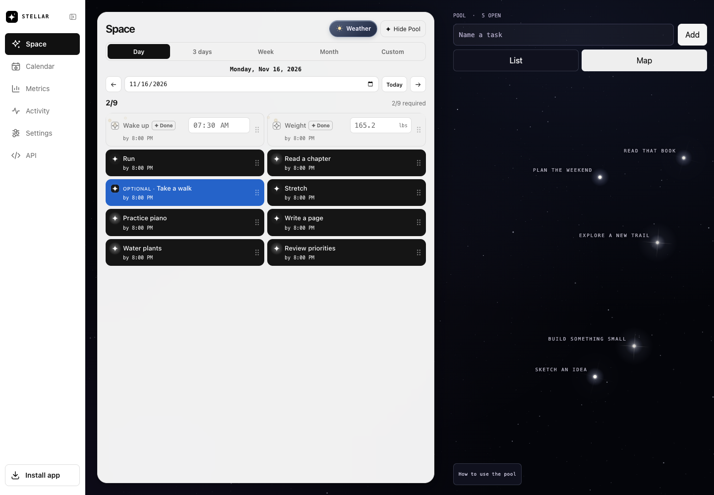
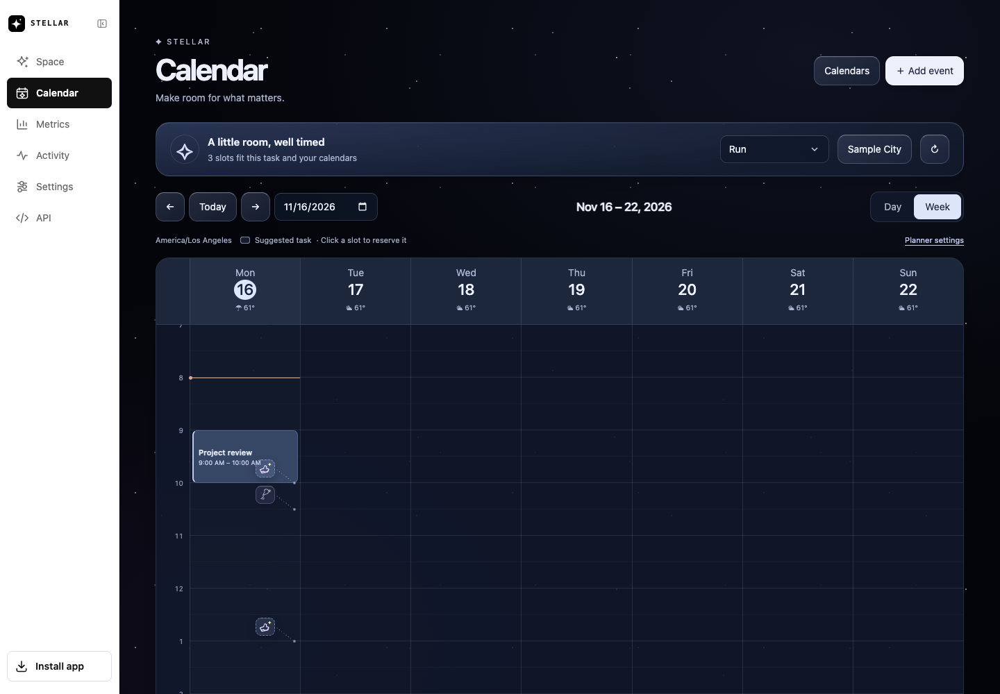
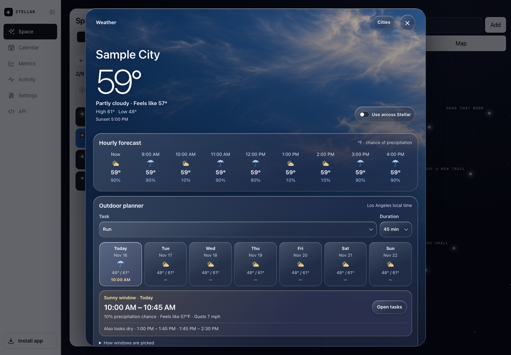
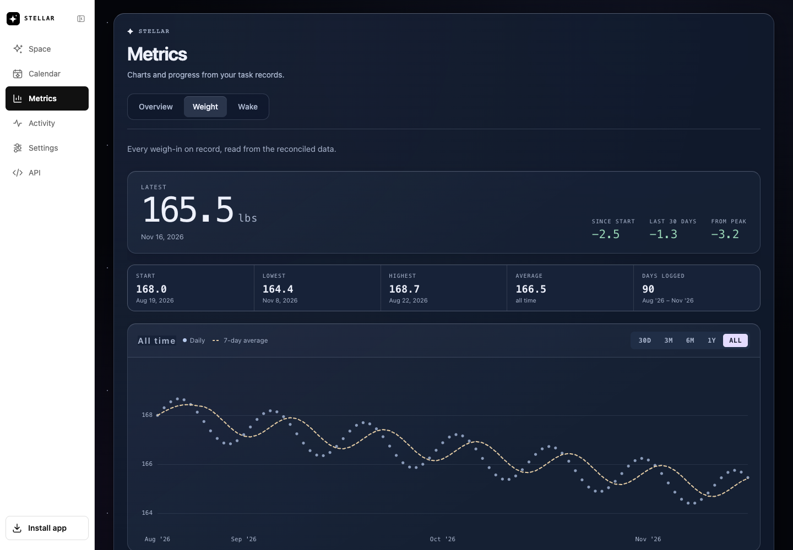
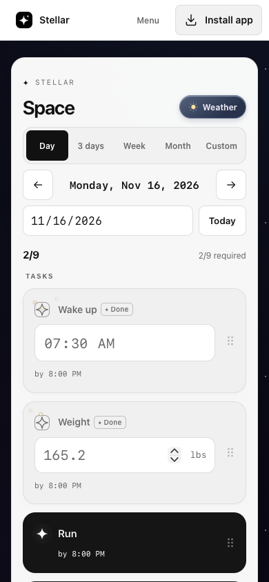
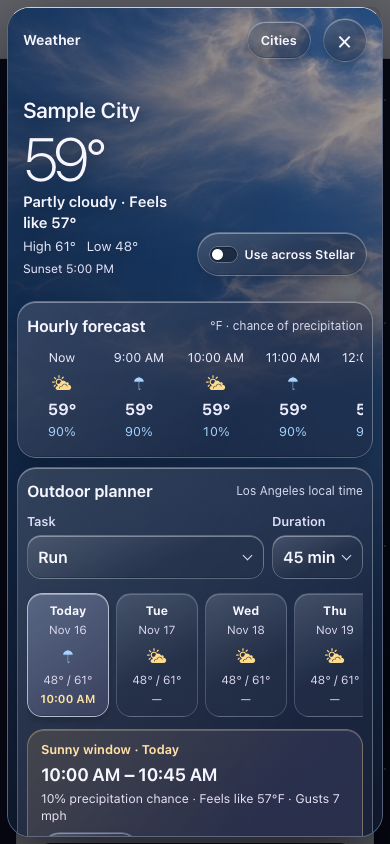
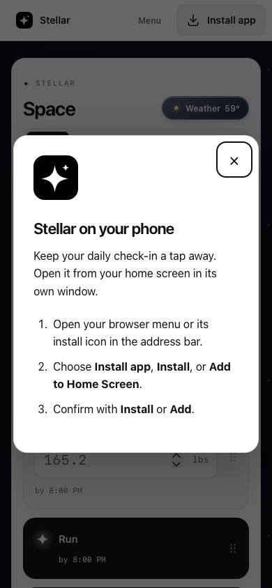

# Stellar

Stellar brings daily tasks, undated ideas, metrics, weather, and a calendar into one
workspace. Check in from a desktop browser or install it on your phone.

## Screenshots

These screenshots show the running app with synthetic tasks, records, and weather.

### Space

Daily tasks float inside Constellations alongside undated work arranged as stars.
Switch between Day, 3 days, Week, Month, and a custom range. Reorder the task list,
move stars, and connect related work.



### Calendar and Weather

Calendar has Day and Week views. The planner suggests several slots that fit a
task’s duration, allowed hours, weather requirements, and existing events. Confirm
a suggestion to reserve it. Short tasks use compact, selectable icons with dotted
leaders to their times. Hover or focus an icon to see its full name.



Weather includes current conditions, hourly forecasts, day/night scenes, and an
outdoor planner. Enable **Use across Stellar** to share the weather background
across tabs. Saved and recent cities make it easy to return to a forecast.



### Metrics

Weight, wake times, and task records live together in Metrics. Task charts default
to the past 365 days, with year choices and **Keep period** for comparisons.



### On a phone

<table>
  <tr><th>Space</th><th>Weather</th><th>Install Stellar</th></tr>
  <tr>
    <td valign="top"></td>
    <td valign="top"></td>
    <td valign="top"></td>
  </tr>
</table>

The installation screenshot shows the app’s own install dialog.

## Using the app

| Route | View |
| --- | --- |
| `/` or `/today` | Space, daily check-in, range views, and Constellations |
| `/calendar` | Timed events and task planning in Day or Week view |
| `/metrics` | Overview, Weight, Wake, and individual task charts |
| `/data` | Activity records |
| `/pool` | Constellations star map and list |
| `/tasks` | Tasks, planning rules, calendar connections, notifications, and appearance |
| `/docs` | Generated API documentation |

Task outcomes include done, incomplete, unreported, and don’t know. Optional tasks
start unreported and sit outside the required daily target. Completing an optional
task adds to the day’s completed count. Measurements have a completion indicator
alongside their input.

Task records are stored in Supabase `task_history`. Recurring definitions generate
each day’s tasks, and the app refreshes records across devices. It remembers view
selections and retains loaded tabs. Space can show cached task records while it
refreshes them from the server.

Configure task duration, time windows, weather limits, and calendar icons under
**Settings → Tasks → Plan**. Calendar connections support Google Calendar,
Outlook, and read-only HTTPS iCalendar subscriptions. Account connections require
provider OAuth setup. The authorization flow prompts for read-only or two-way
access, and event editors show the destination calendar. See the
[calendar connection setup](docs/calendar-connections.md).

## Install on a phone

Open the deployed app in your phone’s browser and tap **Install app** for
browser-specific instructions. Supported Android browsers offer an installation
prompt. On iPhone or iPad, use the browser’s **Add to Home Screen** option.
Sign in with the same account you use on desktop.

The service worker caches the public Space shell and public assets. Task records
also have a local cache for fast startup. Saving check-ins and refreshing records
require a connection. Writes are sent to the server when made.

## Push notifications

New stars default to a reminder after 24 hours. Open a star to change or clear
its reminder, then enable notifications on each device. **Send test** checks
delivery. Resolving or deleting a star cancels pending reminders.

In **Settings → Notifications**, each device can opt into warnings about 30 minutes
before a daily task’s deadline or about three days before an open star collapses.
Stars age from protostars through supernovae. At 90 days, they become black holes
that continue to grow.

For iPhone and iPad, enable notifications from the installed Home Screen app.
See [notification setup](docs/notifications.md).

## Run locally

The web app uses Supabase. The optional Google Tasks importer can also use SQLite.

```bash
python3 -m venv .venv
source .venv/bin/activate
pip install -r requirements.txt
cp .env.example .env
```

Set `STORAGE_BACKEND=supabase`, `SUPABASE_URL`, and `SUPABASE_SECRET_KEY` in `.env`.
The legacy `SUPABASE_SERVICE_ROLE_KEY` variable is also supported. Keep privileged
keys on the server. Apply [the base schema](sql/schema.sql) and the applicable
[SQL migrations](sql/migrations) in order. Back up an existing database before
migrating it.

```bash
make dev
# Open http://localhost:8000
```

For an exposed deployment, create a user in Supabase Auth and set
`SUPABASE_PUBLISHABLE_KEY` and `AUTH_ALLOWED_EMAIL`. Apply
[the authentication lockdown](sql/auth_lockdown.sql). The app uses HTTP-only
session cookies. Production Vercel deployments require authentication.

## Optional Google Tasks import

The importer reads task lists and parses weight and wake notes. It can backfill
records from Google Takeout and pull current tasks through Google’s API.
Calendar account connections are configured separately from this importer.

```bash
pip install -r requirements-sync.txt
make import-takeout FILE=/path/to/takeout.zip
make sync
```

For `make sync`, supply your own Google OAuth desktop client credentials using
`credentials.json` or the environment variables in [.env.example](.env.example).
The first interactive run requests consent and saves `token.json`. These files
and `.env` are ignored by Git. Use `make reauth` to repeat consent.

The [sync workflow](.github/workflows/sync.yml) currently runs manually through
`workflow_dispatch`. Its scheduled triggers are commented out. The separate
[keepalive workflow](.github/workflows/keepalive.yml) runs daily at 06:17 UTC.
The optional `make install-scheduler` installs a local macOS launchd job.

### Google Tasks writes

Record daily outcomes through Stellar. Every Google Tasks API write must go
through a script that defaults to a dry run and is reviewed before applying
changes. Recurring-task edits can affect the whole series. See
[the project working rules](CLAUDE.md).

### Import configuration

- `TASK_LISTS` limits the lists to import. Empty means all lists.
- `WAKE_UP_TASK_TITLE` and `WEIGHT_TASK_TITLE` identify measurement tasks.
- `TITLE_FOLD_THRESHOLD` and `TITLE_ALIASES` reconcile replacement instances with
  their parent task. Folding changes analysis without rewriting stored rows.
- `LOCAL_TIMEZONE` overrides the day-bucketing timezone.
- `INCLUDE_CALENDAR_EVENTS` controls the importer’s calendar-event ingestion.

## Development commands

```bash
make dev                           # Run the web app
make sync                          # Import current Google Tasks
make reauth                        # Repeat Google consent, then import
make import-takeout FILE=take.zip   # Import a Takeout archive
make migrate-supabase              # Copy local SQLite import data to Supabase
make keepalive                     # Ping the configured Supabase database
make help                          # List supported targets
```
